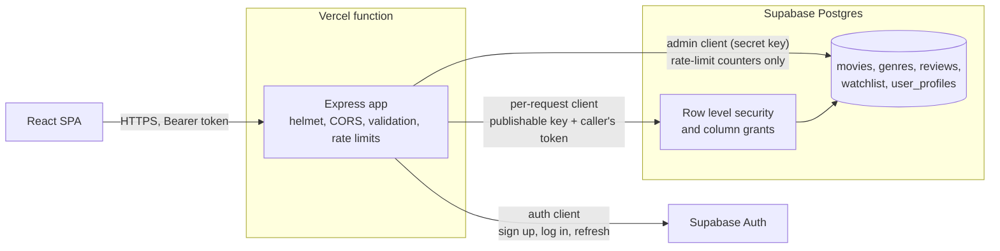

# MovieDB — API

[](https://github.com/kiko4902/web_project_backend/actions/workflows/ci.yml)

The REST API behind [MovieDB](https://movie-frontend-alpha-six.vercel.app), a movie catalogue with search, reviews and watchlists built on the IMDb Top 1000. It is an Express app backed by Supabase (Postgres and Auth). The React client lives in [movie-frontend](https://github.com/kiko4902/movie-frontend).

- **Live site:** https://movie-frontend-alpha-six.vercel.app
- **Live API:** https://moviedb-api-two.vercel.app (try [`/movies?limit=3`](https://moviedb-api-two.vercel.app/movies?limit=3))
- **Demo login:** press **Try the demo account** on the site's [login page](https://movie-frontend-alpha-six.vercel.app/login). Screenshots are in the [frontend README](https://github.com/kiko4902/movie-frontend#screenshots).

## Features

- Paginated movie list with sorting, and search by partial title, genres, year range and minimum rating.
- Registration, login, token refresh and a one-click demo login whose credentials never leave the server.
- Reviews (one per user per movie) and a per-user watchlist.
- Authorization enforced by Postgres row level security, not only by the API.
- Input validation on every route, with consistent JSON errors that do not leak database details.
- Rate limiting on login and registration that works across serverless instances.
- Versioned SQL migrations and a seed file, so the database can be rebuilt from this repository.

## Architecture



### How data access works

The API uses three Supabase clients, each with the least privilege it needs:

| Client      | Key                              | Used for                                                                         |
| ----------- | -------------------------------- | -------------------------------------------------------------------------------- |
| Per-request | publishable key + caller's token | Every read and write on behalf of a user. Row level security applies.            |
| Auth        | publishable key                  | Sign up, log in, refresh. A fresh client per call, so sessions never mix.        |
| Admin       | secret key                       | Rate-limit counters, and the script that creates the demo account. Nothing else. |

Because user requests run as the user, the database decides what they may touch. Anyone can read movies, genres, reviews and usernames. Only the owner can write their own reviews, watchlist rows and profile, and column-level grants stop clients from setting fields such as `created_at` or a movie's rating. The smoke test checks this by calling Supabase directly with the publishable key and confirming the writes are rejected.

Database triggers keep derived data correct: one creates a profile when a user signs up, one maintains each movie's average user rating, and one sets `updated_at` on edited reviews.

## Tech stack

- Node.js 20+, Express 5
- Supabase: Postgres 15, Auth, row level security
- Joi for validation, helmet, cors, express-rate-limit with a Postgres-backed store
- Vitest and supertest
- ESLint and Prettier
- GitHub Actions for CI and a scheduled keep-alive, Vercel for hosting

## API reference

Base URL: `https://moviedb-api-two.vercel.app`. All bodies are JSON. Routes marked 🔒 need an `Authorization: Bearer <access_token>` header.

| Method | Path                  | Auth | Description                                                                 |
| ------ | --------------------- | ---- | --------------------------------------------------------------------------- |
| GET    | `/health`             |      | Liveness check                                                              |
| GET    | `/health/db`          |      | Runs a database query                                                       |
| GET    | `/movies`             |      | Paginated list. Query parameters below.                                     |
| GET    | `/movies/:id`         |      | One movie with its genres and reviews                                       |
| GET    | `/movies/:id/reviews` |      | Reviews for a movie                                                         |
| GET    | `/search`             |      | Same as `/movies`, plus `q` for a partial, case-insensitive title match     |
| GET    | `/genres`             |      | All genres                                                                  |
| POST   | `/auth/register`      |      | Body `{ email, password, username? }`. Returns the user and a session.      |
| POST   | `/auth/login`         |      | Body `{ email, password }`. Returns the user and a session.                 |
| POST   | `/auth/demo`          |      | Logs in as the demo account. 404 if no demo account is configured.          |
| POST   | `/auth/refresh`       |      | Body `{ refresh_token }`. Returns a new session.                            |
| POST   | `/reviews/:movieId`   | 🔒   | Body `{ rating, comment? }`. Rating 1 to 5. 409 if you already reviewed it. |
| PUT    | `/reviews/:id`        | 🔒   | Edit your review. 403 if it is not yours.                                   |
| DELETE | `/reviews/:id`        | 🔒   | Delete your review. Returns 204.                                            |
| GET    | `/watchlist`          | 🔒   | Your watchlist                                                              |
| PUT    | `/watchlist/:movieId` | 🔒   | Add a movie. Safe to repeat.                                                |
| DELETE | `/watchlist/:movieId` | 🔒   | Remove a movie                                                              |
| GET    | `/users/profile`      | 🔒   | Your profile                                                                |
| PUT    | `/users/profile`      | 🔒   | Body `{ username }`                                                         |

Query parameters for `/movies` and `/search`:

| Parameter            | Values                             | Default                           |
| -------------------- | ---------------------------------- | --------------------------------- |
| `page`               | 1 and up                           | 1                                 |
| `limit`              | 1 to 50                            | 20                                |
| `sortBy`             | `title`, `year`, `rating`, `votes` | `title`                           |
| `order`              | `asc`, `desc`                      | `asc` for title, otherwise `desc` |
| `genres`             | comma-separated genre ids          |                                   |
| `minYear`, `maxYear` | release year range                 |                                   |
| `minRating`          | minimum IMDb rating                |                                   |
| `q` (search only)    | part of a title                    |                                   |

List responses look like this:

```json
{
  "data": [{ "id": 1, "title": "The Shawshank Redemption", "year": 1994, "...": "..." }],
  "pagination": { "page": 1, "limit": 20, "total": 1000, "total_pages": 50 }
}
```

A session is `{ access_token, refresh_token, expires_at }`. Errors are `{ "error": "message" }`, with a `details` array for validation failures.

### Rate limits

| Scope                 | Limit                             |
| --------------------- | --------------------------------- |
| All routes, per IP    | 600 requests per 15 minutes       |
| Login, per IP + email | 10 failed attempts per 15 minutes |
| Login, per IP         | 50 failed attempts per 15 minutes |
| Registration, per IP  | 10 per hour                       |

Login and registration counters are stored in Postgres, so they hold across serverless instances. Over the limit, the API returns 429.

## Local setup

You need Node.js 20 or newer and a Supabase project.

```bash
git clone https://github.com/kiko4902/web_project_backend.git
cd web_project_backend
npm install
cp .env.example .env    # then fill it in
npm run db:migrate      # create tables, policies and triggers
npm run db:seed         # load genres and the 1000 movies
npm run dev             # http://localhost:3000
```

On an empty database, `db:migrate` applies everything in `supabase/migrations/` in order. Optionally run `npm run demo:create` to create the demo account named in `.env`.

### Environment variables

| Variable                        | Required | Description                                                                                    |
| ------------------------------- | -------- | ---------------------------------------------------------------------------------------------- |
| `SUPABASE_URL`                  | yes      | Project URL                                                                                    |
| `SUPABASE_PUBLISHABLE_KEY`      | yes      | Publishable key, used with the caller's token so row level security applies                    |
| `SUPABASE_SECRET_KEY`           | yes      | Secret key, server only. Used for rate-limit counters and `demo:create`.                       |
| `CORS_ORIGINS`                  | yes      | Comma-separated browser origins allowed to call the API. `*` matches one hostname segment.     |
| `SUPABASE_DB_URL`               | scripts  | Postgres connection string. Only the `db:*` scripts use it; the deployed API does not need it. |
| `PORT`                          | no       | Local port, default 3000                                                                       |
| `DEMO_EMAIL`, `DEMO_PASSWORD`   | no       | Account behind `POST /auth/demo`                                                               |
| `SMOKE_EMAIL`, `SMOKE_PASSWORD` | no       | Account used by `npm run smoke`                                                                |

`.env` is gitignored. Never commit it.

### Scripts

| Command                       | What it does                                          |
| ----------------------------- | ----------------------------------------------------- |
| `npm run dev`                 | Start with file watching                              |
| `npm start`                   | Start without watching                                |
| `npm test`                    | Run the unit and route tests                          |
| `npm run lint`                | Run ESLint                                            |
| `npm run format`              | Format with Prettier                                  |
| `npm run db:migrate`          | Apply pending migrations (`-- --status` to list them) |
| `npm run db:seed`             | Load `supabase/seed.sql`                              |
| `npm run db:export-seed`      | Regenerate the seed file from the database            |
| `npm run demo:create`         | Create the demo account                               |
| `npm run smoke -- <base URL>` | End-to-end check against a running API                |

## Testing

- **`npm test`** runs 111 tests across 7 files with Vitest and supertest. The app is built by `createApp({ config, supabase })`, so the tests inject a fake Supabase client and need no network or database.
- **`npm run smoke -- <base URL>`** runs 39 checks against a real deployment: health, listing, search, registration, login, refresh, demo login, the review and watchlist lifecycles, ownership (403 for another user's review), the login rate limit, and direct Supabase writes with the publishable key being rejected by row level security.
- CI runs lint, the format check, the tests and a boot check on every push and pull request.

## Database migrations

Schema changes live in `supabase/migrations/` as timestamped SQL files and are applied with `npm run db:migrate`, which records each one in `supabase_migrations.schema_migrations`. The first file is a baseline of the schema as it existed before migrations were introduced.

## Deployment

The API runs on Vercel as a single function.

- `api/index.js` exports the Express app, and `vercel.json` rewrites every path to it.
- Set `SUPABASE_URL`, `SUPABASE_PUBLISHABLE_KEY`, `SUPABASE_SECRET_KEY`, `CORS_ORIGINS` and, for the demo button, `DEMO_EMAIL` and `DEMO_PASSWORD` in the Vercel project.
- Deploy with `vercel --prod`, then run `npm run smoke -- <your URL>`.
- `.github/workflows/keepalive.yml` calls `/health/db` twice a week, because Supabase may pause free projects after a week without activity.

## Data

Movie data comes from the public IMDb Top 1000 dataset. This project is not affiliated with IMDb.
